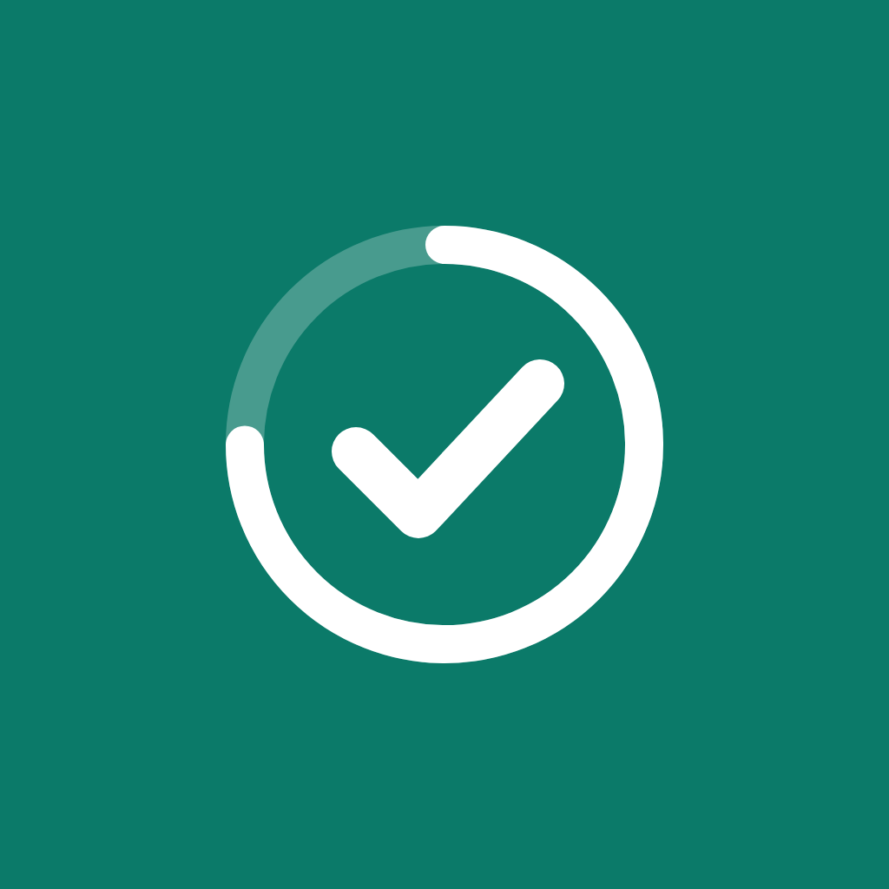
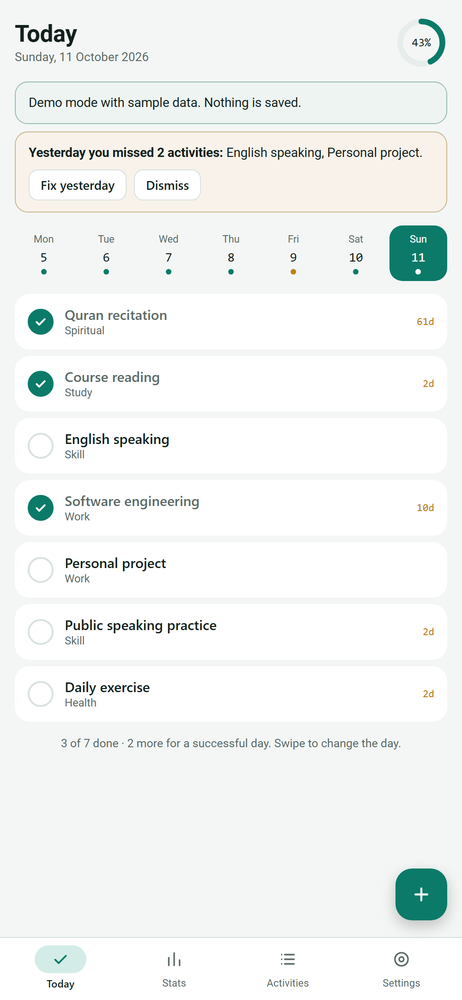
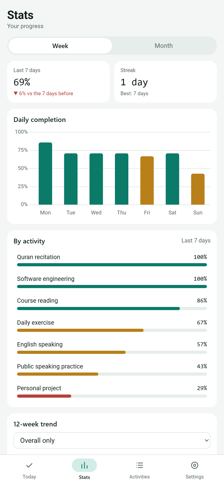
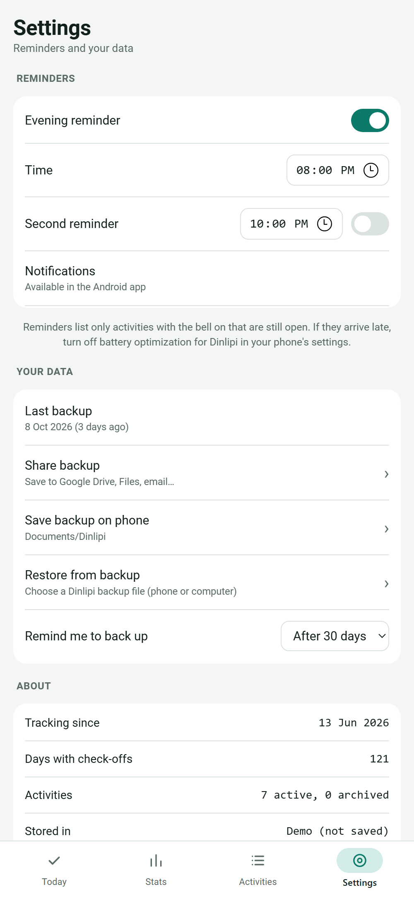

  

<h1 align="center">Dinlipi</h1>

A simple, private daily habit tracker for Android. Tick off your activities, get one evening reminder, and watch your weekly and monthly progress.

  <a href="https://github.com/shawondiu/dinlipi/releases/latest"><b>⬇ Download the latest APK</b></a>

  
  
  

Screenshots use sample data.

## Features

- **Daily checklist** with a 7-day strip; swipe to fix a day you forgot
- **Weekday schedules** (e.g. exercise every day except Friday); rest days never lower your score
- **One evening reminder** at 20:00 (or each activity's own time) listing only what is still open, delivered even when the app is closed. Optional second reminder. Never hourly.
- **Stats**: weekly and monthly efficiency, streaks, daily completion chart, per-activity progress, 12-week trend and a consistency calendar
- **Archive** instead of delete; deleting needs **three confirmations**
- **Your data stays on your phone** in a SQLite database. No account, no server, no tracking.
- **Manual backup and restore** as a JSON file (share to Google Drive, Files, email…), with undo after a restore and a gentle "time to back up" reminder
- Light and dark mode follow your phone

## Install on your Android phone

1. On your phone, open **[Releases](https://github.com/shawondiu/dinlipi/releases/latest)** and tap `Dinlipi-x.y.z.apk` to download it.
2. Open the downloaded file. If Android asks, allow your browser to **install unknown apps**.
3. Tap **Install**. If Google Play Protect warns about an unknown developer, choose **More details → Install anyway**. (The app is not on the Play Store, so Android does not know it.)
4. Open Dinlipi and allow notifications so the evening reminder can reach you.

**Updating:** download the newer APK and install it over the old one. Your data stays.

**Moving from the desktop version:** in the desktop app make a backup, copy the `dinlipi-backup-….json` file to your phone, then in Dinlipi go to **Settings → Restore from backup**.

> Make a backup now and then (**Settings → Share backup**). If you lose or reset your phone, the backup is how you get your history back.

## Make your own copy

You are welcome to fork this project and change it (MIT License).

1. Click **Fork** at the top of this page.
2. In your fork, open **Actions**, enable workflows, choose **Build Android APK → Run workflow**.
3. When it finishes, download the APK from the run's **Artifacts**. Without signing secrets it is a debug-signed APK, which installs fine for personal use.
4. To publish signed releases from your fork, add your own `KEYSTORE_BASE64` and `KEYSTORE_PASSWORD` secrets (see [DOCUMENTS.md](DOCUMENTS.md#8-build-sign-release)) and push a tag like `v1.0.0`.

You can also try the interface in a desktop browser: open `www/index.html?demo` through any local web server to see it with sample data.

## How it is built

Plain HTML, CSS and JavaScript wrapped as an Android app with [Capacitor](https://capacitorjs.com/), using
[`@capacitor-community/sqlite`](https://github.com/capacitor-community/sqlite) for storage, Capacitor Local Notifications
for reminders and [Chart.js](https://www.chartjs.org/) for charts. GitHub Actions builds and signs the APK; nothing needs
to be installed on your computer.

Full technical documentation, data model and rules for changes: **[DOCUMENTS.md](DOCUMENTS.md)**.

## License

[MIT](LICENSE) © 2026 shawondiu
